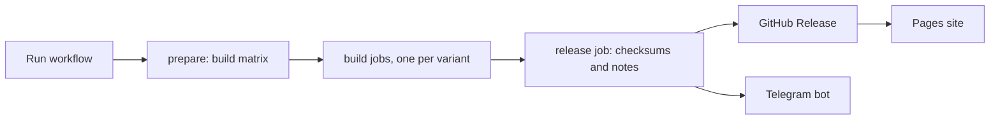

# HyperCore

**GKI kernels for Android, built in the cloud with GitHub Actions.**

KernelSU and its forks, SUSFS, Baseband Guard, BBRv3, NTSync, DroidSpaces, zram tuning and more.
Pick the options, run one workflow, get flashable zips, checksums, a GitHub Release, a Pages site and a Telegram post.

[Downloads](https://github.com/sandtomatowich-hubexe/HyperCore/releases) |
[Build site](https://sandtomatowich-hubexe.github.io/HyperCore/) |
[Which build do I pick?](#which-build-do-i-pick) |
[Credits](#credits)

---

## Contents

1. [Overview](#overview)
2. [How it works](#how-it-works)
3. [Features](#features)
4. [Which build do I pick?](#which-build-do-i-pick)
5. [Flashing](#flashing)
6. [Root managers](#root-managers)
7. [Build it yourself](#build-it-yourself)
8. [Workflow options](#workflow-options)
9. [Kernel source](#kernel-source)
10. [Exact kernel version](#exact-kernel-version)
11. [Telegram releases](#telegram-releases)
12. [Troubleshooting](#troubleshooting)
13. [Repository layout](#repository-layout)
14. [FAQ](#faq)
15. [Credits](#credits)
16. [Star history](#star-history)
17. [Disclaimer](#disclaimer)

## Overview

HyperCore is a kernel build pipeline together with the kernels it produces. It targets Android devices that run a
Generic Kernel Image (GKI). You choose a root solution, a set of kernel options and a kernel line, run a single
GitHub Actions workflow, and receive:

- flashable AnyKernel3 zips, one per build variant, with SHA-256 and MD5 checksum files;
- a GitHub Release with generated notes (kernel version, compiler, SUSFS version, changelogs);
- a GitHub Pages site that lists every build by kernel line and root variant;
- an optional Telegram post per kernel, sent by your own bot.

The default target is the **Poco X6 Pro (duchamp)** on the **GKI 6.1** line, using the kernel source from
`ahmed-alnassif/GKI-Duchamp-6.1`. The pipeline can also build the 5.10, 5.15, 6.6 and 6.12 lines for other
devices that use the same GKI line. Set the repository variable `KERNEL_REPO` to use your own device source.

## How it works

1. **prepare** reads your inputs and expands them into a matrix, one entry per variant and kernel line.
2. Each **build job** runs `build.sh` on its own runner. It installs the Neutron clang toolchain, clones the kernel
   source, then applies patches in this order: BBRv3, NTSync, Baseband Guard, DroidSpaces fixes, the selected root
   solution, SUSFS, multi-manager signatures, zram options and Re:Kernel. After that it writes the defconfig from the
   config fragments in `configs/`, compiles, and packs an AnyKernel3 zip.
3. The **release job** collects every zip, writes checksums, builds the release notes, creates the GitHub Release and
   posts to Telegram.
4. The **Deploy site** workflow publishes `site/`, which reads the Release list from the GitHub API.

A build stops with a clear error when something it was asked to do cannot be done (an upstream branch is gone, a patch
does not apply). It does not silently skip the step and hand you a kernel that is missing a feature.

## Features

| Area | What you get |
|---|---|
| Root | KernelSU, KernelSU-Next (pershoot's SUSFS fork), BakaSU, FinaSU, or no root (Vanilla) |
| Hiding | SUSFS kernel and root-side support, with the compatibility fixes each fork needs |
| Managers | KernelSU builds accept several managers' signatures; BakaSU and KernelSU-Next try the same patch and fall back to their own support; FinaSU trusts its own manager |
| Network | TCP BBRv3, BBR as the default congestion control |
| Scheduler and memory | 300 Hz tick, MGLRU enabled by default, ThinLTO or Full LTO |
| zram | Optional LZ4 + ZSTD, optional LZ4K / LZ4KD with an upgraded LZ4 and a NEON decompressor |
| Protection | Baseband Guard |
| Compatibility | NTSync, DroidSpaces, NetHunter, NoMount, Re:Kernel |

### Root solutions

- **KernelSU** (tiann): the original. Builds apply the multi-manager patch from this repository.
- **KernelSU-Next**: built from pershoot's `dev-susfs` fork, which already ships SUSFS, plus two SUSFS fixes.
- **BakaSU**: built from its `main` branch (formerly ReSukiSU lineage). Kbuild and SUSFS compatibility fixes are applied.
- **FinaSU**: integrated into the kernel tree by hand because its own setup script clones upstream KernelSU. Its
  manager certificate is added to a second trust slot so the official FinaSU manager is recognised. FinaSU on 6.1 is
  experimental.

### SUSFS

SUSFS has a kernel part and a root part. The kernel part always comes from susfs4ksu. The root part is applied only to
forks that do not already ship it (KernelSU), and skipped for forks that do (KernelSU-Next dev-susfs, BakaSU, and FinaSU
when it ships SUSFS natively). The SUSFS version used is shown in every release.

### zram options

- **ZSTD** adds ZSTD next to LZ4. LZ4 stays the default. zram and the crypto algorithms are built in, because GKI ships
  them as modules from the ROM.
- **LZ4KD** upgrades the in-kernel LZ4 library, adds an ARM64 NEON decompressor, and adds the LZ4K, LZ4KD and LZ4K_OPLUS
  algorithms using the zram patches from SukiSU_patch. It needs network access to that repository at build time.

### Other kernel features

- **Baseband Guard** is a small LSM that protects baseband-related partitions.
- **NTSync** is a backport of the NT synchronisation driver used by Wine-based tools.
- **DroidSpaces** enables the namespace, cgroup and filesystem options container runtimes need.
- **NoMount** adds kernel support for the NoMount project. It is off by default.
- **Re:Kernel** builds the Re-Kernel driver into the kernel. It reports activity of frozen apps to userspace freezer
  apps.
- **NetHunter** support is enabled by default, with Realtek USB Wi-Fi drivers in the WirelessKSU module.

## Which build do I pick?

Start with a **Compat** build if you are not sure. It disables LTO and adds extra netfilter and filesystem options, and
it fixes most boot problems.

| Build | Root | SUSFS | Use it when |
|---|---|---|---|
| `Vanilla` | none | no | You want the tuned kernel without root |
| `Vanilla+NoLTO` | none | no | Vanilla, but safer to boot |
| `KSU` | KernelSU | no | Plain KernelSU |
| `KSU+SUSFS` | KernelSU | yes | KernelSU with hiding |
| `Compat+KSU+SUSFS` | KernelSU | yes | The standard build does not boot |
| `Compat+NoDS+KSU+SUSFS` | KernelSU | yes | Compat without DroidSpaces and NetHunter, the most conservative build |
| `BSU+SUSFS`, `Compat+BSU+SUSFS`, `Compat+NoDS+BSU+SUSFS` | BakaSU | yes | You use the BakaSU manager |
| `KSUN+SUSFS`, `Compat+KSUN+SUSFS` | KernelSU-Next | yes | You use the KernelSU-Next manager |
| `FINA+SUSFS`, `Compat+FINA+SUSFS` | FinaSU | yes | You use the FinaSU manager (experimental) |

LTO is `fullLTO` by default and can be changed per run. Compat and `Vanilla+NoLTO` builds always use no LTO.
Build names can carry tags such as `+MM`, `+ZSTD`, `+LZ4KD` and `+REKERNEL`, which tell you what is inside.

## Flashing

1. **Back up your stock `boot.img`.** A wrong kernel can bootloop the phone, and the backup is your way out.
2. Download the zip for your kernel line (for the Poco X6 Pro that is **6.1**) from
   [Releases](https://github.com/sandtomatowich-hubexe/HyperCore/releases) and check it against `checksums.txt`.
3. Flash the zip with Kernel Flasher or a custom recovery. It only touches the boot partition.
4. Reboot, then install the manager that matches your root build (see below).
5. If the phone bootloops or root is missing, flash a **Compat** build, or restore the stock `boot.img` with fastboot.

A kernel zip only fits devices on the **same GKI line and Android version**. The kernel version in the file name must
match what your phone runs.

## Root managers

Install the manager that belongs to the variant you flashed. They are not interchangeable: multi-manager support widens
what the kernel accepts, it does not turn one app into another.

| Variant | Manager |
|---|---|
| KernelSU | [tiann/KernelSU](https://github.com/tiann/KernelSU) |
| KernelSU-Next | [KernelSU-Next/KernelSU-Next](https://github.com/KernelSU-Next/KernelSU-Next) |
| BakaSU | [Baka-SU/BakaSU](https://github.com/Baka-SU/BakaSU) |
| FinaSU | [LyraVoid/FinaSU](https://github.com/LyraVoid/FinaSU) |

SUSFS hides things through a userspace module on top of the kernel part. Any SUSFS module that matches your root manager
works.

## Build it yourself

1. Create a repository on your own account and push these files to it.
2. Settings, Pages, Source: **GitHub Actions**. This publishes the build site.
3. Optional repository variables (Settings, Secrets and variables, Actions, Variables):

   | Variable | Purpose |
   |---|---|
   | `KERNEL_REPO`, `KERNEL_BRANCH`, `KERNEL_BRANCH_NH` | Kernel source for the 6.1 base. See [Kernel source](#kernel-source) |
   | `KERNEL_REPO_<base>`, `KERNEL_BRANCH_<base>` | Kernel source for any base, written `5_10`, `5_15`, `6_1`, `6_6`, `6_12` |
   | `KERNEL_BRAND` | Prefix of the zip names (default `GKI`) |
   | `ANYKERNEL_REPO` | Your AnyKernel3 repository |
   | `BSU_REF`, `KSUN_REF`, `KSUN_REPO`, `FINA_REF` | Pin a root fork to another branch, tag or repository |
   | `SUSFS_COMMIT` | Pin susfs4ksu to one commit for every variant (default: the branch tip) |
   | `ALLOW_SKIPPED_PATCHES` | `true` lets an exact-version build continue when some patches do not apply |
   | `BSU_ALLOW_SUSFS_MISMATCH` | `true` removes BakaSU's own SUSFS version guard. Off by default, because it can produce a kernel that builds but misbehaves |

4. Optional repository secrets for Telegram: `BOT_TOKEN`, `CHAT_ID`, `TOPIC_ID`. See [Telegram releases](#telegram-releases).
5. Actions, **Kernel Builder**, Run workflow. Choose your options and wait. The first test run, with seven 6.1 variants
   building in parallel, took about 33 minutes.
6. Download the zips from the run artifacts, the Release, or the Pages site.

Start with one variant when testing changes, then enable the rest. A failure in one variant does not stop the others.

## Workflow options

| Input | Default | What it does |
|---|---|---|
| `KERNEL_VERSION` | `6.1` | Kernel line: `5.10`, `5.15`, `6.1`, `6.6`, `6.12` or `All` |
| `KERNEL_EXACT_VERSION` | empty | Exact Linux version inside the selected line, for example `6.1.180`. Empty keeps the branch default. See [Exact kernel version](#exact-kernel-version) |
| `LTO` | `fullLTO` | `noneLTO`, `thinLTO` or `fullLTO`. Full LTO is the slowest and needs the most RAM |
| `BUILD_VANILLA` | on | Vanilla and Vanilla+NoLTO |
| `BUILD_KSU` | on | KernelSU without SUSFS |
| `BUILD_KSU_SUSFS` | on | KernelSU and BakaSU with SUSFS, standard and Compat |
| `BUILD_KSUN_SUSFS` | off | KernelSU-Next with SUSFS |
| `BUILD_FINA_SUSFS` | off | FinaSU with SUSFS |
| `MM` | on | Try the multi-manager signature patch on BakaSU and KernelSU-Next |
| `ZSTD` | off | zram with LZ4 and ZSTD |
| `LZ4KD` | off | zram LZ4K, LZ4KD and LZ4K_OPLUS, with an upgraded LZ4 and NEON decompressor |
| `REKERNEL` | off | Re:Kernel, built in from Sakion-Team/Re-Kernel |
| `DROIDSPACES` | on | DroidSpaces container support |
| `NH` | on | NetHunter support |
| `NM` | off | NoMount |
| `CLEAN_LTO_CACHE` | on | Clears the ThinLTO cache to avoid a known `.config` bug |
| `TODO` | `kernel` | `defconfig` exports the generated defconfig instead of building a kernel |
| `TEST` | `no` | `yes` skips the compile and produces placeholder zips, to test the pipeline |

## Kernel source

HyperCore is the build and workflow repository. The kernel itself is fetched from an **external repository**, and the job
summary says so explicitly.

| Base | Default repository | Default branch |
|---|---|---|
| 6.1 | `ahmed-alnassif/GKI-Duchamp-6.1` (the device source) | `GKID-NH` when `NH` is on (the default), otherwise `GKID-6.1` |
| 5.10 | `android.googlesource.com/kernel/common` | `android12-5.10-lts` |
| 5.15 | `android.googlesource.com/kernel/common` | `android13-5.15-lts` |
| 6.6 | `android.googlesource.com/kernel/common` | `android15-6.6-lts` |
| 6.12 | `android.googlesource.com/kernel/common` | `android16-6.12-lts` |

The defaults are intentional upstream sources and are not hardcoded into the workflow file. To use your own source, set
repository variables. The most specific one wins:

1. `KERNEL_REPO_<base>` and `KERNEL_BRANCH_<base>` for any base, for example `KERNEL_REPO_5_10`.
2. For 6.1 only: `KERNEL_REPO`, and `KERNEL_BRANCH` (or `KERNEL_BRANCH_NH` for NetHunter builds).
3. The built-in defaults above.

`KERNEL_REPO` and `KERNEL_BRANCH` without a base suffix apply to 6.1 only. They are ignored, with a warning, for the other
bases, so a device repository can never be built as the wrong kernel line. A repository is an `https://` URL or
`owner/repo`; the branch is configured separately from the repository.

After cloning, the build reads the repository, branch, commit and tag back from the checked-out tree and compares them with
what was configured. If they differ, the build stops. The job summary then lists this repository and its commit, the kernel
source repository and where its value came from (built-in default or which variable), the branch, the resolved commit with
a link, the tag if any, the submodule commits, the kernel base, the requested exact version and the resulting Linux version.
It works together with [Exact kernel version](#exact-kernel-version): the exact version is searched on the configured
repository and branch.

## Exact kernel version

`KERNEL_VERSION` selects the kernel line. `KERNEL_EXACT_VERSION` optionally selects one release inside it.

| KERNEL_VERSION | KERNEL_EXACT_VERSION | Result |
|---|---|---|
| `6.1` | empty | The current branch tip, exactly as before |
| `6.1` | `6.1.180` | The source state that reports Linux 6.1.180 |
| `5.10` | `5.10.209` | The source state that reports Linux 5.10.209 |
| `5.10` | `6.1.180` | Rejected before anything is built: 6.1.180 belongs to the 6.1 line |
| `All` | `6.1.180` | Rejected: an exact version needs a single kernel line |

**Where the source comes from.** GKI kernels need Android's patches (ABI, vendor hooks), so a plain kernel.org tag would
not be a GKI kernel. The exact version is therefore searched on the [configured kernel source](#kernel-source): by default the
device repository for 6.1, and the Android Common Kernel `-lts` branches for 5.10, 5.15, 6.6 and 6.12. Those branches merge every
upstream stable release, so each release appears in their history.

**How the version is found.** The branch history is fetched without file contents, then a binary search over the
`VERSION`, `PATCHLEVEL` and `SUBLEVEL` lines of the top-level Makefile finds the last commit that still reports the
requested version. That is the branch state right before the next release was merged, so it contains the fixes that
landed for that release. After checkout, `make kernelversion` must report exactly the requested version or the build stops.
If the version does not exist on the branch, the error names the nearest versions that do.

**What is recorded.** Every build, with or without an exact version, writes the kernel repository, branch, resolved commit
and susfs4ksu commit to the job summary, and the release notes show the kernel and susfs4ksu commits.

**Compatibility.** The patch set is written against the current branch tips, so older releases can need extra care:

| Area | Behaviour with an exact version |
|---|---|
| SUSFS | The patch matches the susfs4ksu branch tip. For an older release, pin a matching revision with `SUSFS_COMMIT` |
| Kernel patches (BBRv3, NTSync, DroidSpaces, KernelSU hooks) | Applied with the same fuzz as always. A patch that does not apply is listed in the job summary. With an exact version the build then **stops**, so a feature is never silently missing. Set the variable `ALLOW_SKIPPED_PATCHES` to `true` to build without those patches |
| LZ4KD | Needs zram patches for that release in SukiSU_patch; the build stops with a message if they are missing |
| 6.1 | Built from the device repository, so only releases present in its history exist, and older ones may predate its device patches |
| Other lines | Android Common Kernel history; the first fetch is larger than a normal clone |

Default builds (empty `KERNEL_EXACT_VERSION`) behave exactly as before: skipped patches are only reported, not fatal.

## Telegram releases

When a run finishes, your bot posts every kernel as its own message.

**What a message contains**

- a table with the kernel version, a link to the kernel source and branch, the toolchain, and the LTO mode;
- a second table with the feature switches: Mountless Engine (NoMount), Droidspaces, Re:Kernel, NTSync, Baseband Guard,
  LZ4+ZSTD, LZ4KD and MGLRU, each shown as Enable or Disable;
- a button for the root solution with its version and the SUSFS version, linking to the project;
- buttons for the Release, the CI run and the commit;
- the kernel zip itself, attached as a file.

These are Telegram **rich messages** (Bot API 10.3). They need a recent Telegram client to display. If Telegram refuses
the rich message for any reason, the bot sends the same information as a normal file with a text caption, so the zip
always arrives. If part of the build failed, an extra message tells you so and links to the run.

**Setup**

1. Create a bot with [@BotFather](https://t.me/BotFather) and copy its token.
2. Add the bot to your channel or group. For a channel, make it an **administrator** with permission to post.
3. Find the chat id. For a public channel use `@channelname`. For a group or private channel, send a message there and
   open `https://api.telegram.org/bot<YOUR_TOKEN>/getUpdates` in your browser. The id is the `chat.id` value, which starts
   with `-100` for channels.
4. In the repository, Settings, Secrets and variables, Actions, New repository secret: add `BOT_TOKEN` and `CHAT_ID`.
   Add `TOPIC_ID` only if you post into a forum topic.

> Never put the token in a file, an issue or a chat message. If it leaks, revoke it in BotFather with `/revoke`.
> Telegram bots can upload files up to 50 MB. Larger zips are skipped and stay on the Release page.

## Troubleshooting

| Problem | What to try |
|---|---|
| Bootloop after flashing | Flash a `Compat` build, or restore the stock `boot.img` |
| Manager says "not installed" | The manager must match the variant (FinaSU needs its own manager, BakaSU its own, and so on) |
| `has no branch/tag 'x'` | That branch does not exist on the fork. Set `BSU_REF`, `KSUN_REF`, `KSUN_REPO` or `FINA_REF` |
| `duplicate symbol: my_...` or `undefined symbol: my_...` while linking BakaSU | The SUSFS hooks are classified from the real source at build time, so this should not happen any more. If it does, send the `BakaSU SUSFS hook check` table from the job summary |
| `BakaSU blocks this SUSFS revision` | BakaSU's maintainers refuse SUSFS revisions they have not caught up with. Pin `SUSFS_COMMIT` to a revision that works, or pin `BSU_REF` |
| `X does not exist on ... Nearest versions` | That Linux release is not in the branch history. Use one of the versions named in the message |
| `belongs to the 6.1 line, but the selected kernel base is 5.10` | The exact version and `KERNEL_VERSION` must be the same line |
| `patches above do not apply to it` | The exact release is too old or too new for the patch set. Pin `SUSFS_COMMIT`, choose another release, or set `ALLOW_SKIPPED_PATCHES=true` |
| `does not apply` for a patch | An upstream fork changed. Open the failed job: the message names the patch and the step |
| `LZ4KD needs ... does not exist` | SukiSU_patch has no zram patches for that kernel line. Turn `LZ4KD` off for that line |
| `sha256sum: '*.zip': No such file` in the release job | Every build failed, so there is nothing to release. Fix the build errors first |
| Full LTO job is cancelled or runs out of memory | Use `thinLTO` |
| Pages deploy fails | Set the Pages source to **GitHub Actions** in the repository settings, then re-run **Deploy site** |
| Telegram step fails | Check that the bot is an admin of the channel and that `CHAT_ID` is correct |

Every build job uploads its build log and any rejected patches as artifacts. That is the first place to look. The
failing step in the job page shows a one-line error.

## Repository layout

| Path | Contents |
|---|---|
| `.github/workflows/` | `build.yml` (kernel builder), `pages.yml` (site), `validate.yml` (sanity checks) |
| `.github/scripts/` | Release notes, Telegram bot and workflow validators |
| `build.sh`, `functions.sh`, `functions-extra.sh` | Build logic |
| `configs/` | Kernel config fragments |
| `kernel-patches/`, `patches/` | Kernel and root-fork patches |
| `zram/` | Upgraded LZ4 library and NEON decompressor used by the LZ4KD option |
| `py/` | Build matrix and KMI helpers |
| `scripts/finasu/` | FinaSU manager certificate helper |
| `modules/WirelessKSU/` | Realtek USB Wi-Fi drivers for NetHunter |
| `site/` | The GitHub Pages site |

## FAQ

**Can I build for a different device?** Yes, if it runs a GKI kernel. Set `KERNEL_REPO` to your device's kernel source
and pick the matching `KERNEL_VERSION`. The kernel source branch is set in the workflow.

**Do I have to enable every option?** No. The defaults give a sensible set. Options marked off in the table above are
experimental or niche.

**Why are there Compat builds?** LTO and some config options can stop a kernel from booting on certain devices. Compat
builds drop LTO and add extra options so they boot more widely, at the cost of some performance.

**Why do some builds fail while others pass?** Each variant pulls different upstream code. A failure in one fork does not
affect the others, and the error message names the cause.

**Can I use my own AnyKernel3?** Yes. Set the `ANYKERNEL_REPO` variable.

## Credits

HyperCore stands on a lot of other people's work. Thank you to all of them.

**Build pipeline**

- [GKID-Kernels](https://github.com/ahmed-alnassif/GKID-Kernels) by Ahmed Al-Nassif: the workflow, build scripts,
  configs, kernel patches, WirelessKSU module and release tooling this repository started from. Also the device kernel
  source ([GKI-Duchamp-6.1](https://github.com/ahmed-alnassif/GKI-Duchamp-6.1)) and the AnyKernel3 config it uses.
- [GKI_KernelSU_SUSFS](https://github.com/WildKernels/GKI_KernelSU_SUSFS) by WildKernels and
  [GKI_KernelSU_SUSFS](https://github.com/zzh20188/GKI_KernelSU_SUSFS) by zzh20188: KernelSU-Next, BakaSU and FinaSU
  integration approaches, SUSFS compatibility fixes.
- [AnyKernel3](https://github.com/LingLuo17/AnyKernel3) by LingLuo17: FinaSU in-tree integration and manager
  certificate handling, Re:Kernel integration steps, and the upgraded LZ4 and NEON files in `zram/`.
- [SukiSU_patch](https://github.com/ShirkNeko/SukiSU_patch) by ShirkNeko: LZ4K, LZ4KD and LZ4K_OPLUS zram sources and patches.

**Root and hiding**

- [KernelSU](https://github.com/tiann/KernelSU) by tiann and its forks:
  [KernelSU-Next](https://github.com/KernelSU-Next/KernelSU-Next) (with pershoot's
  [SUSFS fork](https://github.com/pershoot/KernelSU-Next)), [BakaSU](https://github.com/Baka-SU/BakaSU) and
  [FinaSU](https://github.com/LyraVoid/FinaSU)
- [susfs4ksu](https://gitlab.com/simonpunk/susfs4ksu) by simonpunk

**Kernel features**

- [Baseband Guard](https://github.com/vc-teahouse/Baseband-guard) by vc-teahouse
- [NoMount](https://github.com/maxsteeel/nomount) by maxsteeel
- [NTSync patches](https://github.com/WildKernels/kernel_patches) by WildKernels
- [DroidSpaces](https://github.com/ravindu644/Droidspaces-OSS) by ravindu644
- [Re-Kernel](https://github.com/Sakion-Team/Re-Kernel) by Sakion-Team

**Toolchain**

- [AnyKernel3](https://github.com/osm0sis/AnyKernel3) by osm0sis
- [Neutron Clang](https://github.com/Neutron-Toolchains) by Neutron-Toolchains
- The Android Common Kernel by Google and the Linux kernel community

The full list, with what each project is used for, is in [CREDITS.md](CREDITS.md). If you maintain one of these projects
and want the credit changed, please open an issue.

**License.** HyperCore is derived from GKID-Kernels and is licensed under **GPL-3.0**, with the original copyright and
authorship notices kept. See [LICENSE](LICENSE) and [NOTICE.md](NOTICE.md) for what changed.

## Star history

<a href="https://www.star-history.com/#sandtomatowich-hubexe/HyperCore&Date">
  <picture>
    <source media="(prefers-color-scheme: dark)" srcset="https://api.star-history.com/svg?repos=sandtomatowich-hubexe/HyperCore&type=Date&theme=dark" />
    <source media="(prefers-color-scheme: light)" srcset="https://api.star-history.com/svg?repos=sandtomatowich-hubexe/HyperCore&type=Date" />
    
  </picture>
</a>

## Disclaimer

Flashing a custom kernel can bootloop or brick your device and can break features that depend on a stock kernel. Back up
your boot image and your data first, and make sure you understand how to restore them. These builds come with no
warranty. You flash them at your own risk.

### Root implementation variants

The workflow can optionally build SukiSU (`builtin` branch) with SUSFS and KowSU as a standalone root variant. KowSU is deliberately kept separate because its current integration does not support SUSFS. RKSU and MamboSU are exposed as opt-in SUSFS variants; set the repository variables `RKSU_REPO` / `MAMBOSU_REPO` to the exact `owner/repository` and, if needed, `RKSU_REF` / `MAMBOSU_REF` to the desired branch before enabling them. These two integrations require a successful full kernel build to confirm compatibility with the selected upstream revision.
