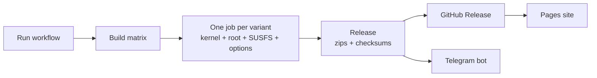

# HyperCore

**GKI kernels for Android, built in the cloud with GitHub Actions.**
KernelSU and its forks, SUSFS, Baseband Guard, BBRv3, NTSync, DroidSpaces and more, one click per build.

[Downloads](https://github.com/sandtomatowich-hubexe/HyperCore/releases) ·
[Build site](https://sandtomatowich-hubexe.github.io/HyperCore/) ·
[Which build do I pick?](#-which-build-do-i-pick) ·
[Credits](#-credits)

---

## Contents

- [What is this?](#-what-is-this)
- [Features](#-features)
- [Which build do I pick?](#-which-build-do-i-pick)
- [Flashing](#-flashing)
- [Root managers](#-root-managers)
- [Build it yourself](#-build-it-yourself)
- [Workflow options](#-workflow-options)
- [Telegram releases](#-telegram-releases)
- [Troubleshooting](#-troubleshooting)
- [Repository layout](#-repository-layout)
- [Credits](#-credits)
- [Star history](#-star-history)
- [Disclaimer](#-disclaimer)

## 📖 What is this?

HyperCore is a build pipeline plus the kernels it produces. You pick a root solution, options and a kernel line, run one workflow, and get flashable AnyKernel3 zips, checksums and a GitHub Release. A Pages site lists the builds, and an optional Telegram bot posts every finished build to your chat.

The default target is the **Poco X6 Pro (duchamp)** on the **GKI 6.1** line. The kernel source comes from `ahmed-alnassif/GKI-Duchamp-6.1`. The pipeline can also build 5.10, 5.15, 6.6 and 6.12 for other devices that use the same GKI line.

## ✨ Features

| Area | What you get |
|---|---|
| **Root** | KernelSU, [KernelSU-Next](https://github.com/KernelSU-Next/KernelSU-Next) (SUSFS fork by pershoot), [BakaSU](https://github.com/Baka-SU/BakaSU), [FinaSU](https://github.com/LyraVoid/FinaSU), or no root at all (Vanilla) |
| **SUSFS** | Kernel-side hiding from [susfs4ksu](https://gitlab.com/simonpunk/susfs4ksu), with the fixes each root fork needs |
| **Multi-manager** | KernelSU builds accept several managers' signatures. BakaSU and KernelSU-Next try the same patch and fall back to their own support. FinaSU trusts its own manager through a second signature slot |
| **Networking** | TCP BBRv3 as the default congestion control |
| **Performance** | 300 Hz tick, MGLRU, optional LZ4 + ZSTD zram, ThinLTO or Full LTO |
| **Safety** | Baseband Guard, which protects baseband partitions from accidental wipes |
| **Extras** | NTSync (Wine/Winlator), DroidSpaces containers, NetHunter, NoMount, Re:Kernel |
| **Tooling** | Build matrix, ccache, checksums, release notes, GitHub Pages site, Telegram bot |

> Only features that are enabled in the workflow end up in a zip. The zip name tells you what is inside, for example `+MM`, `+ZSTD`, `+REKERNEL`.

## 🎯 Which build do I pick?

Start with a **Compat** build if you are not sure. It drops LTO and adds extra netfilter and filesystem options, and it fixes most boot problems.

| Build | Root | SUSFS | LTO | Use it when |
|---|---|---|---|---|
| `Vanilla` | none | no | yes | You want the tuned kernel without root |
| `Vanilla+NoLTO` | none | no | no | Vanilla, but safer to boot |
| `KSU` | KernelSU | no | yes | Plain KernelSU |
| `KSU+SUSFS` | KernelSU | yes | yes | KernelSU with hiding. The best-tested path |
| `Compat+KSU+SUSFS` | KernelSU | yes | no | The standard build does not boot |
| `Compat+NoDS+KSU+SUSFS` | KernelSU | yes | no | Compat without DroidSpaces and NetHunter, the most conservative build |
| `BSU+SUSFS` and the Compat variants | BakaSU | yes | yes / no | You use the BakaSU manager |
| `KSUN+SUSFS` and `Compat+KSUN+SUSFS` | KernelSU-Next | yes | yes / no | You use the KernelSU-Next manager |
| `FINA+SUSFS` and `Compat+FINA+SUSFS` | FinaSU | yes | yes / no | You use the FinaSU manager (experimental on 6.1) |

*LTO column is the workflow default. You can switch the LTO level for a run (see [options](#-workflow-options)).*

## ⚡ Flashing

1. **Back up your stock `boot.img`.** A wrong kernel can bootloop the phone, and the backup is your way out.
2. Download the zip for your kernel line (for the Poco X6 Pro that is **6.1**) from [Releases](https://github.com/sandtomatowich-hubexe/HyperCore/releases) and check it against `checksums.txt`.
3. Flash the zip with Kernel Flasher or a custom recovery (boot partition only).
4. Reboot and install the manager that matches your root build (see below).
5. Bootloop or no root? Flash a **Compat** build, or restore the stock `boot.img` with fastboot.

> A kernel zip only fits devices on the **same GKI line and Android version**. The kernel version in the file name must match what your phone runs.

## 🔑 Root managers

Install the manager that belongs to the variant you flashed. They are not interchangeable (multi-manager support widens what the kernel accepts, it does not turn one app into another).

| Variant | Manager |
|---|---|
| KernelSU | [tiann/KernelSU](https://github.com/tiann/KernelSU) |
| KernelSU-Next | [KernelSU-Next/KernelSU-Next](https://github.com/KernelSU-Next/KernelSU-Next) |
| BakaSU | [Baka-SU/BakaSU](https://github.com/Baka-SU/BakaSU) |
| FinaSU | [LyraVoid/FinaSU](https://github.com/LyraVoid/FinaSU) |

SUSFS hides things through a userspace module on top of the kernel part. Any SUSFS module that matches your root manager works.

## 🛠️ Build it yourself

1. **Create a repository** on your own account and push these files to it.
2. **Settings → Pages → Source: GitHub Actions** (this publishes the build site).
3. **Optional repository variables** (Settings → Secrets and variables → Actions → Variables):

   | Variable | Purpose |
   |---|---|
   | `KERNEL_REPO` | Your device's GKI kernel source (default: `ahmed-alnassif/GKI-Duchamp-6.1`) |
   | `KERNEL_BRAND` | Prefix of the zip names (default `GKI`) |
   | `ANYKERNEL_REPO` | Your AnyKernel3 repository |
   | `BSU_REF`, `KSUN_REF`, `KSUN_REPO`, `FINA_REF` | Pin a root fork to another branch or tag |

4. **Actions → Kernel Builder → Run workflow**, choose your options, and wait. The first test run, with seven 6.1 variants building in parallel, took about 33 minutes.
5. Download the zips from the run's artifacts, the Release, or the Pages site.

## 🎛️ Workflow options

| Input | Default | What it does |
|---|---|---|
| `KERNEL_VERSION` | `6.1` | Kernel line: `5.10`, `5.15`, `6.1`, `6.6`, `6.12` or `All` |
| `LTO` | `fullLTO` | `noneLTO`, `thinLTO` or `fullLTO`. Full LTO is the slowest and needs the most RAM |
| `BUILD_VANILLA` | on | Vanilla and Vanilla+NoLTO |
| `BUILD_KSU` | on | KernelSU without SUSFS |
| `BUILD_KSU_SUSFS` | on | KernelSU and BakaSU with SUSFS, standard and Compat |
| `BUILD_KSUN_SUSFS` | off | KernelSU-Next with SUSFS |
| `BUILD_FINA_SUSFS` | off | FinaSU with SUSFS |
| `MM` | on | Try the multi-manager signature patch on BakaSU and KernelSU-Next |
| `ZSTD` | off | zram with LZ4 and ZSTD |
| `LZ4KD` | off | zram LZ4KD (needs `extra-patches/lz4kd.patch`) |
| `REKERNEL` | off | Re:Kernel, built in from Sakion-Team/Re-Kernel |
| `DROIDSPACES` | on | DroidSpaces container support |
| `NH` | on | NetHunter support |
| `NM` | off | NoMount |
| `CLEAN_LTO_CACHE` | on | Clears the ThinLTO cache to avoid a known `.config` bug |
| `TODO` | `kernel` | `defconfig` exports the generated defconfig instead of building a kernel |
| `TEST` | `no` | `yes` skips the compile and produces placeholder zips, to test the pipeline |

If an enabled feature needs a patch file that does not exist, the build stops with a clear error instead of silently skipping it.

## 🤖 Telegram releases

When a run finishes, the bot posts a summary and then every kernel zip as a file, plus the checksums. If part of the build failed, you get a warning with the successful kernels attached and a link to the failed run.

1. Create a bot with [@BotFather](https://t.me/BotFather) and copy its token.
2. Add the bot to your channel or group. For a channel, make it an **administrator** with permission to post.
3. Find the chat id: for a public channel use `@channelname`. For a group or private channel, send a message there and open `https://api.telegram.org/bot<YOUR_TOKEN>/getUpdates` in your browser. The id is the `chat.id` value (it starts with `-100` for channels).
4. In the repository: **Settings → Secrets and variables → Actions → New repository secret**, add `BOT_TOKEN` and `CHAT_ID`. Add `TOPIC_ID` only if you post into a forum topic.

> **Never put the token in a file, an issue or a chat message.** If it leaks, revoke it in BotFather with `/revoke`.
> Telegram bots can upload files up to 50 MB. Bigger zips are listed in the message and left on the Release page.

## 🩹 Troubleshooting

| Problem | What to try |
|---|---|
| Bootloop after flashing | Flash a `Compat` build, or restore the stock `boot.img` |
| Manager says "not installed" | The manager must match the variant. FinaSU needs its own manager, BakaSU its own, and so on |
| A BakaSU, KernelSU-Next or FinaSU build fails | Open the failed job: the error names the step. Often an upstream branch moved, so pin it with `BSU_REF`, `KSUN_REF` or `FINA_REF` |
| Run fails with "has no branch/tag" | The branch in the message does not exist on that repository. Set the matching variable above |
| Full LTO job is cancelled or runs out of memory | Use `thinLTO` |
| Pages deploy fails | Set Pages source to **GitHub Actions** in the repository settings, then re-run **Deploy site** |
| Telegram step fails | Check that the bot is an admin of the channel and that `CHAT_ID` is correct |

Each run uploads its build log and any rejected patches as artifacts, which is the first place to look.

## 🗂️ Repository layout

| Path | Contents |
|---|---|
| `.github/workflows/` | `build.yml` (kernel builder), `pages.yml` (site), `validate.yml` (sanity checks) |
| `.github/scripts/` | Release notes, Telegram bot and workflow validators |
| `build.sh`, `functions.sh`, `functions-extra.sh` | Build logic |
| `configs/` | Kernel config fragments |
| `kernel-patches/`, `patches/` | Kernel and root-fork patches |
| `extra-patches/` | Optional patches you supply (for example LZ4KD) |
| `py/` | Build matrix and KMI helpers |
| `scripts/finasu/` | FinaSU manager certificate helper |
| `modules/WirelessKSU/` | Realtek USB Wi-Fi drivers for NetHunter |
| `site/` | The GitHub Pages site |

## 🙏 Credits

HyperCore stands on a lot of other people's work. Thank you to all of them.

**Build pipeline**

- **[GKID-Kernels](https://github.com/ahmed-alnassif/GKID-Kernels)** by Ahmed Al-Nassif: the workflow, build scripts, configs, kernel patches, WirelessKSU module and release tooling this repository started from. Also the device kernel source ([GKI-Duchamp-6.1](https://github.com/ahmed-alnassif/GKI-Duchamp-6.1)) and AnyKernel3 config it uses.
- **[GKI_KernelSU_SUSFS](https://github.com/WildKernels/GKI_KernelSU_SUSFS)** by WildKernels and **[GKI_KernelSU_SUSFS](https://github.com/zzh20188/GKI_KernelSU_SUSFS)** by zzh20188: KernelSU-Next, BakaSU and FinaSU integration approaches, SUSFS compat fixes.
- **[AnyKernel3](https://github.com/LingLuo17/AnyKernel3)** by LingLuo17: FinaSU in-tree integration and manager certificate handling, Re:Kernel integration steps.

**Root and hiding**

- [KernelSU](https://github.com/tiann/KernelSU) by tiann, and its forks: [KernelSU-Next](https://github.com/KernelSU-Next/KernelSU-Next) (with pershoot's [SUSFS fork](https://github.com/pershoot/KernelSU-Next)), [BakaSU / ReSukiSU](https://github.com/Baka-SU/BakaSU), [FinaSU](https://github.com/LyraVoid/FinaSU)
- [susfs4ksu](https://gitlab.com/simonpunk/susfs4ksu) by simonpunk

**Kernel features**

- [Baseband Guard](https://github.com/vc-teahouse/Baseband-guard) by vc-teahouse
- [NoMount](https://github.com/maxsteeel/nomount) by maxsteeel
- [NTSync patches](https://github.com/WildKernels/kernel_patches) by WildKernels
- [DroidSpaces](https://github.com/ravindu644/Droidspaces-OSS) by ravindu644
- [Re-Kernel](https://github.com/Sakion-Team/Re-Kernel) by Sakion-Team

**Toolchain**

- [AnyKernel3](https://github.com/osm0sis/AnyKernel3) by osm0sis
- [Neutron Clang](https://github.com/Neutron-Toolchains) by Neutron-Toolchains
- The Android Common Kernel by Google and the Linux kernel community

The full list, with what each project is used for, is in [CREDITS.md](CREDITS.md). If you maintain one of these projects and want the credit changed, please open an issue.

**License.** HyperCore is derived from GKID-Kernels and is licensed under **GPL-3.0**, with the original copyright and authorship notices kept. See [LICENSE](LICENSE) and [NOTICE.md](NOTICE.md) for what changed.

## ⭐ Star history

<a href="https://www.star-history.com/#sandtomatowich-hubexe/HyperCore&Date">
  <picture>
    <source media="(prefers-color-scheme: dark)" srcset="https://api.star-history.com/svg?repos=sandtomatowich-hubexe/HyperCore&type=Date&theme=dark" />
    <source media="(prefers-color-scheme: light)" srcset="https://api.star-history.com/svg?repos=sandtomatowich-hubexe/HyperCore&type=Date" />
    
  </picture>
</a>

## ⚠️ Disclaimer

Flashing a custom kernel can bootloop or brick your device and can break features that depend on a stock kernel. Back up your boot image and your data first, and make sure you understand how to restore them. These builds come with no warranty. You flash them at your own risk.
